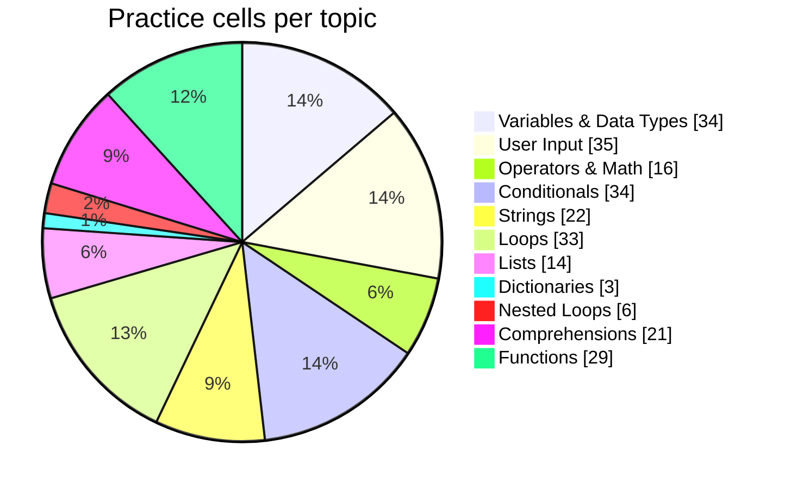

<h1 align="center">🐍 Phantom's Python Practice Journey</h1>

<i>Learning in public: daily Colab practice, tracked automatically.</i>

## 📊 Live Dashboard

| 🎯 Current topic | 📈 Level | 📝 Latest section | 🔥 Streak | 🗓️ Days practiced | 🧮 Code cells |
|---|---|---|---|---|---|
| **Comprehensions** | 🟡 Intermediate | Comprehensions | 1 days | 1 | 44 |

## 🗺️ Topic Roadmap

| Level | Topic | Practice depth | Cells | Status |
|---|---|---|---|---|
| 🟢 Beginner | Variables & Data Types | `██████████` | 34 | 🟢 Strong |
| 🟢 Beginner | User Input | `██████████` | 35 | 🟢 Strong |
| 🟢 Beginner | Operators & Math | `██████████` | 16 | 🟢 Strong |
| 🟢 Beginner | Conditionals | `██████████` | 34 | 🟢 Strong |
| 🟢 Beginner | Strings | `██████████` | 22 | 🟢 Strong |
| 🟢 Beginner | Loops | `██████████` | 33 | 🟢 Strong |
| 🟡 Intermediate | Lists | `██████████` | 14 | 🟢 Strong |
| 🟡 Intermediate | Tuples | `░░░░░░░░░░` | 0 | ⬜ Not started |
| 🟡 Intermediate | Sets | `░░░░░░░░░░` | 0 | ⬜ Not started |
| 🟡 Intermediate | Dictionaries | `████░░░░░░` | 3 | 🟠 Practicing |
| 🟡 Intermediate | Nested Loops | `████████░░` | 6 | 🟠 Practicing |
| 🟡 Intermediate | Comprehensions | `██████████` | 21 | 🟢 Strong |
| 🟡 Intermediate | Functions | `██████████` | 29 | 🟢 Strong |
| 🟡 Intermediate | Lambda, Map & Filter | `░░░░░░░░░░` | 0 | ⬜ Not started |
| 🟡 Intermediate | Error Handling | `░░░░░░░░░░` | 0 | ⬜ Not started |
| 🟡 Intermediate | File Handling | `░░░░░░░░░░` | 0 | ⬜ Not started |
| 🔴 Advanced | Recursion | `░░░░░░░░░░` | 0 | ⬜ Not started |
| 🔴 Advanced | OOP (Classes) | `░░░░░░░░░░` | 0 | ⬜ Not started |
| 🔴 Advanced | Decorators & Generators | `░░░░░░░░░░` | 0 | ⬜ Not started |
| 🔴 Advanced | NumPy | `░░░░░░░░░░` | 0 | ⬜ Not started |
| 🔴 Advanced | Pandas | `░░░░░░░░░░` | 0 | ⬜ Not started |
| 🔴 Advanced | Visualization | `░░░░░░░░░░` | 0 | ⬜ Not started |

## 🥧 Practice Distribution

## 📓 Notebooks

| Notebook | Code cells | Run it |
|---|---|---|
| [Practice.ipynb](notebooks/Practice.ipynb) | 9 |  |
| [PRACTICE2.ipynb](notebooks/PRACTICE2.ipynb) | 35 |  |

## 🔥 Activity

  

  

---
Auto-generated on 12 Oct 2026, 08:49 UTC by GitHub Actions from the notebooks in this repo.
