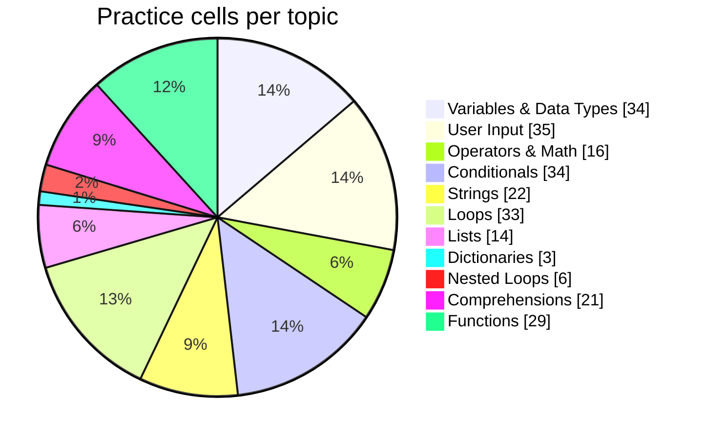

  

  

## 📊 Live Dashboard

| 🎯 Current topic | 📈 Level | 📝 Latest section | 🔥 Streak | 🗓️ Days practiced | 🧮 Code cells |
|---|---|---|---|---|---|
| **Comprehensions** | 🟡 Intermediate | Comprehensions | 1 days | 1 | 44 |

## 📈 Learning Growth

_The growth graph fills in as you practice on more days._

## 🗺️ Topic Roadmap

| Level | Topic | Practice depth | Cells | Status |
|---|---|---|---|---|
| 🟢 Beginner | Variables & Data Types | `██████████` | 34 | 🟢 Strong |
| 🟢 Beginner | User Input | `██████████` | 35 | 🟢 Strong |
| 🟢 Beginner | Operators & Math | `██████████` | 16 | 🟢 Strong |
| 🟢 Beginner | Conditionals | `██████████` | 34 | 🟢 Strong |
| 🟢 Beginner | Strings | `██████████` | 22 | 🟢 Strong |
| 🟢 Beginner | Loops | `██████████` | 33 | 🟢 Strong |
| 🟡 Intermediate | Lists | `██████████` | 14 | 🟢 Strong |
| 🟡 Intermediate | Tuples | `░░░░░░░░░░` | 0 | ⬜ Not started |
| 🟡 Intermediate | Sets | `░░░░░░░░░░` | 0 | ⬜ Not started |
| 🟡 Intermediate | Dictionaries | `████░░░░░░` | 3 | 🟠 Practicing |
| 🟡 Intermediate | Nested Loops | `████████░░` | 6 | 🟠 Practicing |
| 🟡 Intermediate | Comprehensions | `██████████` | 21 | 🟢 Strong |
| 🟡 Intermediate | Functions | `██████████` | 29 | 🟢 Strong |
| 🟡 Intermediate | Lambda, Map & Filter | `░░░░░░░░░░` | 0 | ⬜ Not started |
| 🟡 Intermediate | Error Handling | `░░░░░░░░░░` | 0 | ⬜ Not started |
| 🟡 Intermediate | File Handling | `░░░░░░░░░░` | 0 | ⬜ Not started |
| 🔴 Advanced | Recursion | `░░░░░░░░░░` | 0 | ⬜ Not started |
| 🔴 Advanced | OOP (Classes) | `░░░░░░░░░░` | 0 | ⬜ Not started |
| 🔴 Advanced | Decorators & Generators | `░░░░░░░░░░` | 0 | ⬜ Not started |
| 🔴 Advanced | NumPy | `░░░░░░░░░░` | 0 | ⬜ Not started |
| 🔴 Advanced | Pandas | `░░░░░░░░░░` | 0 | ⬜ Not started |
| 🔴 Advanced | Visualization | `░░░░░░░░░░` | 0 | ⬜ Not started |

## 🥧 Practice Distribution

## 📓 Notebooks

| Notebook | Code cells | Run it |
|---|---|---|
| [Practice.ipynb](notebooks/Practice.ipynb) | 9 |  |
| [PRACTICE2.ipynb](notebooks/PRACTICE2.ipynb) | 35 |  |

## 🧩 Coding Platforms

 

### 🟠 LeetCode: [@affankotwal](https://leetcode.com/u/affankotwal)

| Recently solved | Difficulty | Date |
|---|---|---|
| [Longest Common Prefix](https://leetcode.com/problems/longest-common-prefix/) | 🟢 Easy | 27 Jan 2026 |
| [Remove K Digits](https://leetcode.com/problems/remove-k-digits/) | 🟡 Medium | 21 Jan 2026 |
| [Sort Colors](https://leetcode.com/problems/sort-colors/) | 🟡 Medium | 21 Jan 2026 |
| [Container With Most Water](https://leetcode.com/problems/container-with-most-water/) | 🟡 Medium | 21 Jan 2026 |
| [Regular Expression Matching](https://leetcode.com/problems/regular-expression-matching/) | 🔴 Hard | 21 Jan 2026 |
| [Palindrome Number](https://leetcode.com/problems/palindrome-number/) | 🟢 Easy | 21 Jan 2026 |
| [String to Integer (atoi)](https://leetcode.com/problems/string-to-integer-atoi/) | 🟡 Medium | 21 Jan 2026 |
| [Reverse Integer](https://leetcode.com/problems/reverse-integer/) | 🟡 Medium | 21 Jan 2026 |
| [Median of Two Sorted Arrays](https://leetcode.com/problems/median-of-two-sorted-arrays/) | 🔴 Hard | 21 Jan 2026 |
| [Longest Substring Without Repeating Characters](https://leetcode.com/problems/longest-substring-without-repeating-characters/) | 🟡 Medium | 21 Jan 2026 |

### 🟢 HackerRank: [@affankotwal](https://www.hackerrank.com/profile/affankotwal)

| Badge | Stars | Solved |
|---|---|---|
| Problem Solving | ⭐⭐ | 11 |
| C++ | ⭐⭐⭐⭐⭐ | 18 |
| Java | ⭐⭐⭐ | 13 |
| Python | ⭐⭐ | 9 |
| C | ⭐⭐⭐⭐ | 17 |

## 🔥 Activity

  

  

---
Auto-generated on 12 Oct 2026, 09:18 UTC by GitHub Actions from the notebooks in this repo.
