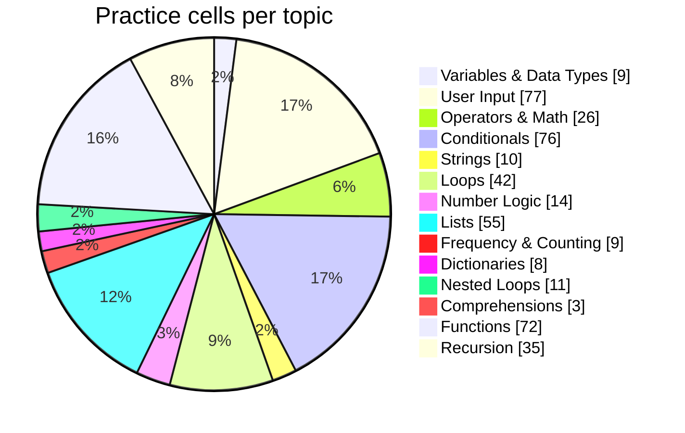

<p align="center">
  
</p>
<p align="center">
  
</p>

<p align="center">


</p>

## 📑 Table of Contents

- [Project Highlights](#project-highlights)
- [How to Use This Repository](#how-to-use-this-repository)
- [Live Dashboard](#live-dashboard)
- [Learning Growth](#learning-growth)
- [Topic Roadmap](#topic-roadmap)
- [Practice Distribution](#practice-distribution)
- [Notebooks](#notebooks)
- [Coding Platforms](#coding-platforms)
  - [LeetCode](#leetcode)
  - [HackerRank](#hackerrank)
- [Activity](#activity)

---

<a id="project-highlights"></a>
## 💡 Project Highlights

- **Python problem solving:** Practice programming fundamentals and progressively explore more advanced concepts.
- **Jupyter notebooks:** Keep exercises, examples, experiments, and solutions in an interactive format.
- **Workflow automation:** Use GitHub Actions to regenerate repository documentation when relevant files change.
- **Automated dashboards:** Generate topic-progress summaries, practice charts, and SVG visuals using Python.
- **API integration and caching:** Collect coding-platform statistics and retain previously synced data when requests fail.
- **Learning in public:** Document my learning journey, including practice exercises and ongoing progress, rather than showing only selected polished examples.

<a id="how-to-use-this-repository"></a>
## 🚀 How to Use This Repository

- **Browse notebooks:** Open the notebooks to explore my exercises, examples, and experiments.
- **Run online:** Use the Google Colab links in the notebook table to open supported notebooks in your browser.
- **Run locally:** Install Python and Jupyter to execute notebook cells on your computer.
- **Track progress:** Explore the dashboard, roadmap, and charts to see the topics detected in my practice notebooks.
- **Explore coding profiles:** Visit the linked LeetCode and HackerRank sections to review the displayed platform statistics.

### Run Locally

Clone the repository:

```bash
 git clone https://github.com/Phantom2101/Python-Daily-Practice.git
 cd Python-Daily-Practice
```

Install Jupyter Notebook:

```bash
python -m pip install notebook
```

Start Jupyter Notebook:

```bash
jupyter notebook
```

Open a notebook and run its cells. Some notebooks may require additional Python libraries; install those dependencies if prompted. These instructions assume Python is already installed.

<a id="live-dashboard"></a>
## 📊 Live Dashboard

| 🎯 Current topic | 📈 Difficulty | 📝 Latest question | 🔥 Streak | 🗓️ Days practiced | 🧮 Code cells |
|---|---|---|---|---|---|
| **Recursion** | 🔴 Hard | Hard Recursion — Find the Second Largest Number | 6 days | 6 | 87 |

> **How to read these metrics:** The practice-day count is based on distinct Git commit dates for files under `notebooks/`. The streak is calculated from those dates and counts consecutive days ending today or yesterday. It is not the same as activity on LeetCode or HackerRank.

<a id="learning-growth"></a>
## 📈 Learning Growth



**87** code cells so far across **6** practice days, averaging **+8.2 cells per day** since the first push.

<a id="topic-roadmap"></a>
## 🗺️ Topic Roadmap

The roadmap is generated by analysing code patterns in the practice notebooks. Cell counts show where patterns were detected; they do **not** measure mastery or guarantee that a topic has been fully learned. The practice-depth bar and status are simple activity indicators based on detected cell counts.

| Level | Topic | Practice depth | Cells | Status |
|---|---|---|---|---|
| 🟢 Beginner | Variables & Data Types | `██████████` | 9 | 🟢 Strong |
| 🟢 Beginner | User Input | `██████████` | 77 | 🟢 Strong |
| 🟢 Beginner | Operators & Math | `██████████` | 26 | 🟢 Strong |
| 🟢 Beginner | Conditionals | `██████████` | 76 | 🟢 Strong |
| 🟢 Beginner | Strings | `██████████` | 10 | 🟢 Strong |
| 🟢 Beginner | Loops | `██████████` | 42 | 🟢 Strong |
| 🟡 Intermediate | Number Logic | `██████████` | 14 | 🟢 Strong |
| 🟡 Intermediate | Lists | `██████████` | 55 | 🟢 Strong |
| 🟡 Intermediate | Frequency & Counting | `██████████` | 9 | 🟢 Strong |
| 🟡 Intermediate | Tuples | `░░░░░░░░░░` | 0 | ⬜ Not started |
| 🟡 Intermediate | Sets | `░░░░░░░░░░` | 0 | ⬜ Not started |
| 🟡 Intermediate | Dictionaries | `██████████` | 8 | 🟢 Strong |
| 🟡 Intermediate | Nested Loops | `██████████` | 11 | 🟢 Strong |
| 🟡 Intermediate | Comprehensions | `████░░░░░░` | 3 | 🟠 Practicing |
| 🟡 Intermediate | Functions | `██████████` | 72 | 🟢 Strong |
| 🟡 Intermediate | Lambda, Map & Filter | `░░░░░░░░░░` | 0 | ⬜ Not started |
| 🟡 Intermediate | Error Handling | `░░░░░░░░░░` | 0 | ⬜ Not started |
| 🟡 Intermediate | File Handling | `░░░░░░░░░░` | 0 | ⬜ Not started |
| 🔴 Advanced | Recursion | `██████████` | 35 | 🟢 Strong |
| 🔴 Advanced | OOP (Classes) | `░░░░░░░░░░` | 0 | ⬜ Not started |
| 🔴 Advanced | Decorators & Generators | `░░░░░░░░░░` | 0 | ⬜ Not started |
| 🔴 Advanced | NumPy | `░░░░░░░░░░` | 0 | ⬜ Not started |
| 🔴 Advanced | Pandas | `░░░░░░░░░░` | 0 | ⬜ Not started |
| 🔴 Advanced | Visualization | `░░░░░░░░░░` | 0 | ⬜ Not started |

**Question difficulty mix:** 🟢 Easy 34 · 🟡 Medium 15 · 🔴 Hard 1

<a id="practice-distribution"></a>
## 🥧 Practice Distribution



<a id="notebooks"></a>
## 📓 Notebooks

Browse the original practice notebooks on GitHub, or use the Colab badge to open a notebook online. The notebooks are kept as a record of my learning process, including exercises and experiments.

| Notebook | Code cells | Run it |
|---|---|---|
| [Practice.ipynb](notebooks/Practice.ipynb) | 10 | [](https://colab.research.google.com/github/Phantom2101/Python-Daily-Practice/blob/main/notebooks/Practice.ipynb) |
| [PRACTICE2.ipynb](notebooks/PRACTICE2.ipynb) | 77 | [](https://colab.research.google.com/github/Phantom2101/Python-Daily-Practice/blob/main/notebooks/PRACTICE2.ipynb) |

<a id="coding-platforms"></a>
## 🧩 Coding Platforms

<p align="center"><a href="https://leetcode.com/u/affankotwal"></a> <a href="https://www.hackerrank.com/profile/affankotwal"></a></p>

### 🟠 LeetCode: [@affankotwal](https://leetcode.com/u/affankotwal)



| Recently solved | Difficulty | Date |
|---|---|---|
| [Add Two Numbers](https://leetcode.com/problems/add-two-numbers/) | 🟡 Medium | 14 Oct 2026 |
| [Two Sum](https://leetcode.com/problems/two-sum/) | 🟢 Easy | 14 Oct 2026 |
| [Longest Common Prefix](https://leetcode.com/problems/longest-common-prefix/) | 🟢 Easy | 27 Jan 2026 |
| [Remove K Digits](https://leetcode.com/problems/remove-k-digits/) | 🟡 Medium | 21 Jan 2026 |
| [Sort Colors](https://leetcode.com/problems/sort-colors/) | 🟡 Medium | 21 Jan 2026 |
| [Container With Most Water](https://leetcode.com/problems/container-with-most-water/) | 🟡 Medium | 21 Jan 2026 |
| [Regular Expression Matching](https://leetcode.com/problems/regular-expression-matching/) | 🔴 Hard | 21 Jan 2026 |
| [Palindrome Number](https://leetcode.com/problems/palindrome-number/) | 🟢 Easy | 21 Jan 2026 |
| [String to Integer (atoi)](https://leetcode.com/problems/string-to-integer-atoi/) | 🟡 Medium | 21 Jan 2026 |
| [Reverse Integer](https://leetcode.com/problems/reverse-integer/) | 🟡 Medium | 21 Jan 2026 |
| [Median of Two Sorted Arrays](https://leetcode.com/problems/median-of-two-sorted-arrays/) | 🔴 Hard | 21 Jan 2026 |
| [Longest Substring Without Repeating Characters](https://leetcode.com/problems/longest-substring-without-repeating-characters/) | 🟡 Medium | 21 Jan 2026 |

### 🟢 HackerRank (Python): [@affankotwal](https://www.hackerrank.com/profile/affankotwal)



_Difficulty bars count the problems listed below; the big number comes from your Python badge._

| Recently solved | Difficulty | Date |
|---|---|---|
| [Find the Runner-Up Score!  ](https://www.hackerrank.com/challenges/find-second-maximum-number-in-a-list/problem) | 🟢 Easy | 09 Oct 2026 |
| [List Comprehensions](https://www.hackerrank.com/challenges/list-comprehensions/problem) | 🟢 Easy | 08 Oct 2026 |
| [Print Function](https://www.hackerrank.com/challenges/python-print/problem) | 🟢 Easy | 08 Oct 2026 |
| [Write a function](https://www.hackerrank.com/challenges/write-a-function/problem) | 🟡 Medium | 08 Oct 2026 |
| [Loops](https://www.hackerrank.com/challenges/python-loops/problem) | 🟢 Easy | 08 Oct 2026 |
| [Python: Division](https://www.hackerrank.com/challenges/python-division/problem) | 🟢 Easy | 08 Oct 2026 |
| [Arithmetic Operators](https://www.hackerrank.com/challenges/python-arithmetic-operators/problem) | 🟢 Easy | 08 Oct 2026 |
| [Python If-Else](https://www.hackerrank.com/challenges/py-if-else/problem) | 🟢 Easy | 08 Oct 2026 |
| [Say "Hello, World!" With Python](https://www.hackerrank.com/challenges/py-hello-world/problem) | 🟢 Easy | 08 Oct 2026 |


<a id="activity"></a>
## 🔥 GitHub Activity

<p align="center">
  
</p>
<p align="center">
  
</p>

---

<sub>Auto-generated on 17 Oct 2026, 20:46 UTC by GitHub Actions from the practice notebooks and coding-platform data.</sub>
