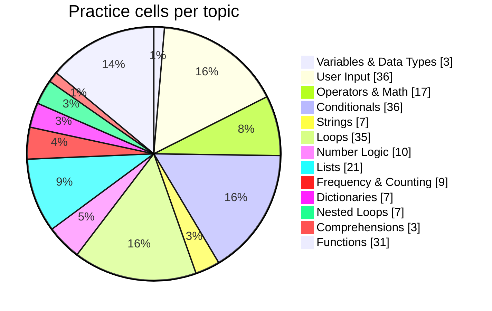

  

  

## 📊 Live Dashboard

| 🎯 Current topic | 📈 Difficulty | 📝 Latest question | 🔥 Streak | 🗓️ Days practiced | 🧮 Code cells |
|---|---|---|---|---|---|
| **Frequency & Counting** | 🟡 Medium | Majority Element — Efficient Version | 1 days | 1 | 45 |

## 📈 Learning Growth

_The growth graph fills in as you practice on more days._

## 🗺️ Topic Roadmap

| Level | Topic | Practice depth | Cells | Status |
|---|---|---|---|---|
| 🟢 Beginner | Variables & Data Types | `████░░░░░░` | 3 | 🟠 Practicing |
| 🟢 Beginner | User Input | `██████████` | 36 | 🟢 Strong |
| 🟢 Beginner | Operators & Math | `██████████` | 17 | 🟢 Strong |
| 🟢 Beginner | Conditionals | `██████████` | 36 | 🟢 Strong |
| 🟢 Beginner | Strings | `█████████░` | 7 | 🟠 Practicing |
| 🟢 Beginner | Loops | `██████████` | 35 | 🟢 Strong |
| 🟡 Intermediate | Number Logic | `██████████` | 10 | 🟢 Strong |
| 🟡 Intermediate | Lists | `██████████` | 21 | 🟢 Strong |
| 🟡 Intermediate | Frequency & Counting | `██████████` | 9 | 🟢 Strong |
| 🟡 Intermediate | Tuples | `░░░░░░░░░░` | 0 | ⬜ Not started |
| 🟡 Intermediate | Sets | `░░░░░░░░░░` | 0 | ⬜ Not started |
| 🟡 Intermediate | Dictionaries | `█████████░` | 7 | 🟠 Practicing |
| 🟡 Intermediate | Nested Loops | `█████████░` | 7 | 🟠 Practicing |
| 🟡 Intermediate | Comprehensions | `████░░░░░░` | 3 | 🟠 Practicing |
| 🟡 Intermediate | Functions | `██████████` | 31 | 🟢 Strong |
| 🟡 Intermediate | Lambda, Map & Filter | `░░░░░░░░░░` | 0 | ⬜ Not started |
| 🟡 Intermediate | Error Handling | `░░░░░░░░░░` | 0 | ⬜ Not started |
| 🟡 Intermediate | File Handling | `░░░░░░░░░░` | 0 | ⬜ Not started |
| 🔴 Advanced | Recursion | `░░░░░░░░░░` | 0 | ⬜ Not started |
| 🔴 Advanced | OOP (Classes) | `░░░░░░░░░░` | 0 | ⬜ Not started |
| 🔴 Advanced | Decorators & Generators | `░░░░░░░░░░` | 0 | ⬜ Not started |
| 🔴 Advanced | NumPy | `░░░░░░░░░░` | 0 | ⬜ Not started |
| 🔴 Advanced | Pandas | `░░░░░░░░░░` | 0 | ⬜ Not started |
| 🔴 Advanced | Visualization | `░░░░░░░░░░` | 0 | ⬜ Not started |

**Question difficulty mix:** 🟢 Easy 0 · 🟡 Medium 9 · 🔴 Hard 0

## 🥧 Practice Distribution

## 📓 Notebooks

| Notebook | Code cells | Run it |
|---|---|---|
| [Practice.ipynb](notebooks/Practice.ipynb) | 9 |  |
| [PRACTICE2.ipynb](notebooks/PRACTICE2.ipynb) | 36 |  |

## 🧩 Coding Platforms

 

### 🟠 LeetCode: [@affankotwal](https://leetcode.com/u/affankotwal)

| Recently solved | Difficulty | Date |
|---|---|---|
| [Longest Common Prefix](https://leetcode.com/problems/longest-common-prefix/) | 🟢 Easy | 27 Jan 2026 |
| [Remove K Digits](https://leetcode.com/problems/remove-k-digits/) | 🟡 Medium | 21 Jan 2026 |
| [Sort Colors](https://leetcode.com/problems/sort-colors/) | 🟡 Medium | 21 Jan 2026 |
| [Container With Most Water](https://leetcode.com/problems/container-with-most-water/) | 🟡 Medium | 21 Jan 2026 |
| [Regular Expression Matching](https://leetcode.com/problems/regular-expression-matching/) | 🔴 Hard | 21 Jan 2026 |
| [Palindrome Number](https://leetcode.com/problems/palindrome-number/) | 🟢 Easy | 21 Jan 2026 |
| [String to Integer (atoi)](https://leetcode.com/problems/string-to-integer-atoi/) | 🟡 Medium | 21 Jan 2026 |
| [Reverse Integer](https://leetcode.com/problems/reverse-integer/) | 🟡 Medium | 21 Jan 2026 |
| [Median of Two Sorted Arrays](https://leetcode.com/problems/median-of-two-sorted-arrays/) | 🔴 Hard | 21 Jan 2026 |
| [Longest Substring Without Repeating Characters](https://leetcode.com/problems/longest-substring-without-repeating-characters/) | 🟡 Medium | 21 Jan 2026 |
| [Two Sum](https://leetcode.com/problems/two-sum/) | 🟢 Easy | 21 Jan 2026 |

### 🟢 HackerRank (Python): [@affankotwal](https://www.hackerrank.com/profile/affankotwal)

_Difficulty bars count the problems listed below; the big number comes from your Python badge._

| Recently solved | Difficulty | Date |
|---|---|---|
| [Find the Runner-Up Score!  ](https://www.hackerrank.com/challenges/find-second-maximum-number-in-a-list/problem) | 🟢 Easy | 09 Oct 2026 |
| [List Comprehensions](https://www.hackerrank.com/challenges/list-comprehensions/problem) | 🟢 Easy | 08 Oct 2026 |
| [Print Function](https://www.hackerrank.com/challenges/python-print/problem) | 🟢 Easy | 08 Oct 2026 |
| [Write a function](https://www.hackerrank.com/challenges/write-a-function/problem) | 🟡 Medium | 08 Oct 2026 |
| [Loops](https://www.hackerrank.com/challenges/python-loops/problem) | 🟢 Easy | 08 Oct 2026 |
| [Python: Division](https://www.hackerrank.com/challenges/python-division/problem) | 🟢 Easy | 08 Oct 2026 |
| [Arithmetic Operators](https://www.hackerrank.com/challenges/python-arithmetic-operators/problem) | 🟢 Easy | 08 Oct 2026 |
| [Python If-Else](https://www.hackerrank.com/challenges/py-if-else/problem) | 🟢 Easy | 08 Oct 2026 |
| [Say "Hello, World!" With Python](https://www.hackerrank.com/challenges/py-hello-world/problem) | 🟢 Easy | 08 Oct 2026 |

## 🔥 Activity

  

  

---
Auto-generated on 12 Oct 2026, 14:29 UTC by GitHub Actions from the notebooks in this repo.
